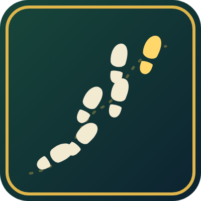

<p align="center">
  
</p>

<h1 align="center">Andarilho</h1>

<p align="center">
  <b>Quantos quilômetros você já caminhou em Azeroth?</b><br>
  Addon para <b>WoW Forever</b> que conta a distância percorrida e converte de yards para metros e km.
</p>

<p align="center">
  
  
  
</p>

---

## O que ele faz

- **Conta o que você realmente andou**, em yards, metros e km.
- **Separa por tipo:** a pé, montado e nadando.
- **Guarda por personagem** e também soma todos os personagens da conta.
- **Mostra hoje e a sessão atual** ao lado do total.
- **Relatório por dia**, com filtros de período, pesquisa por data, média e melhor dia.
- **Janela pequena e móvel**, que minimiza para um ícone no minimapa.
- **Português ou inglês**, automático pelo cliente do WoW ou à sua escolha.
- **Não conta o que não é andar:** Taxi, teleporte, barco, zepelim e correr parado contra a parede.

## Instalação

1. Baixe o zip na página de [Releases](../../releases) ou no CurseForge.
2. Extraia a pasta `Andarilho` em `World of Warcraft\_forever_\Interface\AddOns\`.
3. Entre no jogo. A janela aparece sozinha, e a contagem começa ali.

## Comandos

| Comando | O que faz |
|---|---|
| `/andarilho` | Mostra ou esconde a janela |
| `/andarilho relatorio` | Abre o relatório por dia |
| `/andarilho total` | Escreve os totais no chat |
| `/andarilho idioma auto\|pt\|en` | Escolhe o idioma (automático segue o cliente do WoW) |
| `/andarilho minimapa` | Mostra ou esconde o ícone do minimapa |
| `/andarilho trancar` | Trava ou destrava a posição da janela |
| `/andarilho centro` | Traz a janela de volta ao centro |
| `/andarilho reset confirmar` | Zera a contagem deste personagem |

## Minimapa e relatório

- O botão **−** no canto da janela minimiza o Andarilho. Para abrir de novo, clique no ícone do minimapa.
- **Botão direito** no ícone do minimapa (ou o ícone de nota na janela) abre o relatório.
- No relatório dá para escolher **7 dias, 30 dias ou tudo**, alternar entre **este personagem** e **todos**, e pesquisar por data (`12/11`, `11/2026`) ou dia da semana (`sáb`).
- O histórico por dia começa a ser gravado a partir da versão 1.1.0.

## Como a distância é medida

A cada 0,2 segundo o addon compara a posição atual do personagem com a anterior, mas só enquanto você mesmo está se movendo. Por isso barco e zepelim não contam, e correr contra a parede também não, já que a posição não muda. Saltos maiores do que a velocidade máxima possível, como teleporte e Blink, são descartados.

- **Dungeons:** o jogo não informa a posição, então a distância é estimada pela velocidade base (7 yd/s a pé, 14 montado) enquanto você se move.
- **Altura:** a distância é horizontal, então subir ou cair não soma.
- **Início da contagem:** o jogo não guarda o histórico, então só conta a partir da instalação.
- **Conversão:** 1 yard = 0,9144 m.

## Desenvolvimento

O teste roda fora do jogo, com a API do WoW simulada:

```
lua5.1 tools/test/test.lua Andarilho/Andarilho.lua
```

Para publicar uma versão nova, altere o `## Version` em `Andarilho/Andarilho.toc` e envie para o `main`. O GitHub Actions cria a tag e o Release e envia para o CurseForge.

## English

Andarilho is a **WoW Forever** addon that tracks how far your character has travelled and converts yards to meters and kilometers. It keeps separate totals for on foot, mounted and swimming, per character and across the account, and ignores flight paths, teleports, boats and running into walls. It also keeps a daily history with a searchable report, minimizes to a minimap icon, and follows the game client's language (English or Brazilian Portuguese) unless you pick one. Use `/andarilho` to show or hide the window; `report`, `total`, `language auto|pt|en`, `minimap`, `lock`, `center` and `reset confirm` are also available.

## Créditos

Criado por **Ianes**. Escrito com a ajuda do Claude (Anthropic). Licença [MIT](LICENSE).
